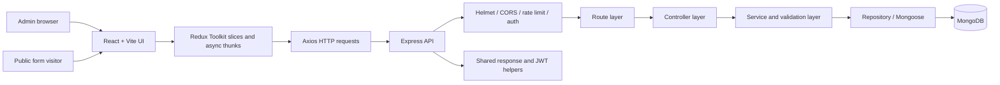
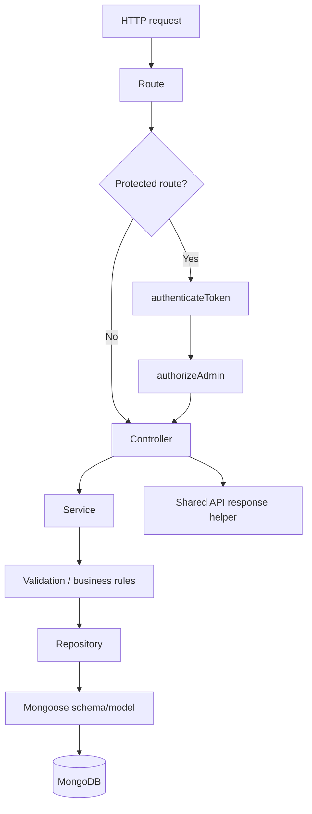

# System Architecture

## 1. Overview

The application is organized as a React/Vite client and an Express/Mongoose API backed by MongoDB.

## 2. Frontend structure

The frontend source is under `client/src`.

| Area | Responsibility |
|---|---|
| `pages/` | Login, dashboard, dynamic form list/builder, submissions |
| `components/` | Reusable controls, tables, drawers, popups, dynamic form renderer |
| `layouts/` | Public and protected application layouts |
| `routes/` | React Router route definitions |
| `redux/actions/` | `createAsyncThunk` actions that call backend APIs through Axios |
| `redux/features/` | Redux slices for authentication, forms, submissions, dashboard and loader |
| `redux/store.js` | Combines slices and registers unauthorized-response middleware |
| `hooks/` | Authentication and toast helpers |
| `utils/` | Field type configuration and date/time helpers |

The Redux store keeps form, submission, dashboard, authentication, and loader state in separate slices. The API base URL is read from `VITE_API_URI`.

Admin requests read the JWT from browser `localStorage` and send it in the `Authorization: Bearer` header. Public form retrieval and public submission requests do not attach the admin token.

## 3. Backend layers

The backend source is under `server/src`.

| Layer | Responsibility |
|---|---|
| `routes/` | Declares endpoint paths and route-level middleware |
| `middleware/` | Verifies bearer JWT and checks admin role |
| `controller/` | Reads request parameters/body and delegates to services |
| `services/` | Applies business rules and form/submission validation |
| `repository/` | Executes Mongoose queries and persistence operations |
| `schema/` | Defines User, Form, and Submission document structures |
| `shared/` | Standard response envelope, message catalog, JWT helpers |
| `config/db.js` | Connects Mongoose to the configured MongoDB database |

`server.js` loads environment variables, configures Helmet, Morgan, CORS, rate limiting and body parsing, mounts the route index under `BASE_URL`, connects to MongoDB, and starts the HTTP server.

## 4. Main request flows

### Admin login

1. The client sends username and password to `POST /user/login`.
2. The user repository finds a non-deleted user and selects the hidden password hash.
3. bcrypt compares the submitted password with the stored hash.
4. The repository checks `isVerified`, updates `lastLoginAt`, and signs a JWT containing `uid`, `userName`, and `role`.
5. The client stores the token and uses it for protected API calls.

### Form creation and management

1. The admin client sends form metadata and field definitions.
2. `authenticateToken` verifies the bearer token and attaches the decoded user to the request.
3. `authorizeAdmin` checks `req.user.role === "admin"`.
4. The controller passes the authenticated UID to the service.
5. `validateFormPayload` validates and normalizes field definitions.
6. The repository persists the form, including generated public `formId`, creator UID, status and timestamps.
7. Form list/get/update/delete queries are scoped to `createdBy` and exclude soft-deleted forms.

### Public form submission

1. A visitor requests `GET /public/forms/:formId`.
2. The API returns only a published, non-deleted form definition.
3. The client renders the fields from the returned `fields` array.
4. The visitor submits values to `POST /public/submissions/forms/:formId/submissions`.
5. The service loads the published form and validates submitted keys and values against its saved field definitions.
6. The repository creates a Submission document with a generated `SUB-...` identifier and answer records.

### Admin submission management

The admin route group supports listing with pagination and filters, reading one submission by ID, and deleting a submission. In the current repository implementation these operations query submissions globally rather than restricting them to the requesting admin's UID.

### Dashboard

The dashboard repository calculates totals, groups submissions by form, fetches the five most recently updated forms and five most recent submissions, and aggregates daily submission activity for the last seven days.

## 5. Authentication and authorization

- Authentication uses JWT signed with `JWT_SECRET`.
- Token expiry is configured through `JWT_TOKEN_EXPIRY`.
- Protected routes require `Authorization: Bearer <token>`.
- `authorizeAdmin` requires the token payload role to equal `admin`.
- User passwords are hashed in the User Mongoose pre-save hook using bcrypt with 12 salt rounds.
- The current User schema defines only the `admin` role.

**Current security limitations to address:**
- Registration is public and new users receive the schema's default `admin` role, although they are initially unverified. No verification route is mounted in the supplied code.
- The login repository checks `isVerified` but does not check the schema's `isActive` flag.
- Submission and dashboard queries are not owner-scoped, unlike form CRUD.
- A production deployment should provision admins through a trusted process, enforce ownership/authorization consistently, and use HTTPS and production secrets.

## 6. Validation

The backend's `formValidation.js`:
- Accepts the nine configured field types.
- Normalizes `key` or `fieldKey` into `fieldKey`.
- Checks field key syntax and uniqueness.
- Checks options for select/radio/checkbox fields.
- Checks min/max configuration ordering and date-range ordering.
- Validates required and unexpected submission keys.
- Validates email, phone, number ranges, text lengths, regex patterns, date bounds and allowed option values.

## 7. Scalability considerations

### Present in the code
- Form and submission list endpoints use page/limit pagination and cap the page size at 100.
- MongoDB indexes support form owner/status/update ordering, public form lookup, and form submission timeline queries.
- Dashboard count/read operations use `Promise.all`.
- Dashboard submission analytics use MongoDB aggregation.

### Not currently present
- Queue workers/background jobs.
- Distributed caching.
- Dedicated analytics storage.
- Automated load tests or evidence of the assessment's 50k+ forms / 10m+ submissions target.

For larger deployments, evaluate cursor-based pagination for deep pages, indexes based on measured query plans, queue-based asynchronous work, caching of public form definitions, rate limits by route/IP/account, and load testing with realistic data volumes. These are recommendations, not current implemented features.
