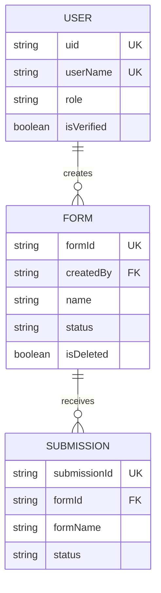

# Database Design

The application uses MongoDB through Mongoose. The inspected backend defines three collections/models: `User`, `Form`, and `Submission`.

## 1. User collection

Model: `User` (`server/src/schema/user.js`)

| Field | Type | Required / default | Purpose |
|---|---|---|---|
| `fullName` | String | Default `""` | Display name |
| `userName` | String | Required, unique, lowercase, trimmed, 3–30 chars | Login identifier |
| `password` | String | Required, min 8 chars, `select: false` | bcrypt password hash |
| `uid` | String | Required, unique, UUID default | Stable user identifier used in JWT and form ownership |
| `role` | String | Enum `admin`, default `admin` | Authorization role |
| `isActive` | Boolean | Default `true` | Account active flag |
| `isDeleted` | Boolean | Default `false` | Soft-delete marker |
| `isVerified` | Boolean | Default `false` | Login verification gate |
| `lastLoginAt` | Date | Default `null` | Last successful login time |
| `createdAt`, `updatedAt` | Date | Mongoose timestamps | Record timestamps |

### Password handling
The User schema has a `pre("save")` hook. When `password` is modified, it generates a bcrypt salt with 12 rounds and hashes the password before persistence. The password field is excluded from normal query selection; login explicitly selects it for comparison.

### Indexes / constraints
- `userName` is unique.
- `uid` is unique.

## 2. Form collection

Model: `Form` (`server/src/schema/form.js`)

| Field | Type | Required / default | Purpose |
|---|---|---|---|
| `formId` | String | Required, unique, generated `FC-XXXXXXXX` | Public identifier used in public URLs |
| `name` | String | Required, trimmed, max 120 | Form title |
| `description` | String | Default `""`, max 500 | Form description |
| `showName` | Boolean | Default `true` | Whether public renderer should show the form name |
| `showDescription` | Boolean | Default `true` | Whether public renderer should show the description |
| `status` | String | `Draft` or `Published`, default `Draft` | Publication state |
| `fields` | Array of Mixed | Default `[]` | Dynamic field definitions |
| `createdBy` | String | Required | Creator's `uid` |
| `updatedBy` | String | Default `null` | Last updater's `uid` |
| `isDeleted` | Boolean | Default `false` | Soft-delete marker |
| `createdAt`, `updatedAt` | Date | Mongoose timestamps | Record timestamps |

### Dynamic field object

The service normalizes each field into this shape:

```json
{
  "id": "field-1",
  "type": "text",
  "label": "Full Name",
  "fieldKey": "fullName",
  "placeholder": "Enter your name",
  "defaultValue": "",
  "required": true,
  "order": 0,
  "validation": {}
}
```

Choice fields add:

```json
"options": [
  { "label": "Option A", "value": "option_a" },
  { "label": "Option B", "value": "option_b" }
]
```

Textarea fields may include `rows`. The backend supports `text`, `email`, `number`, `phone`, `textarea`, `date`, `select`, `radio`, and `checkbox`.

The schema uses `mongoose.Schema.Types.Mixed` for `fields`, allowing different field configurations in the same array. The service layer performs validation and normalizes the incoming fields. Incoming `key` is accepted as an alias and stored as `fieldKey`.

### Indexes
- Unique index on `formId` (also declared with `index: true`).
- `{ createdBy: 1, status: 1, updatedAt: -1 }` for owner/status/recently-updated form queries.
- `{ formId: 1, status: 1, isDeleted: 1 }` for public form lookup.

Form CRUD repository queries are scoped by `createdBy` and `isDeleted: false`. Deletion is soft deletion: the document remains but `isDeleted` becomes `true`.

## 3. Submission collection

Model: `Submission` (`server/src/schema/submission.js`)

| Field | Type | Required / default | Purpose |
|---|---|---|---|
| `submissionId` | String | Required, unique, generated by repository when omitted | Human-readable submission identifier (`SUB-...`) |
| `formId` | String | Required, indexed | Public form identifier to associate the response with |
| `formName` | String | Default `""` | Form name snapshot at submission time |
| `submittedBy` | String | Default `""` | Submitter display name |
| `email` | String | Default `""` | Submitter email summary |
| `mobile` | String | Default `""` | Submitter phone summary |
| `answers` | Array of `{ label, value }` | `label` required; `value` default `""` | Submitted field answers |
| `status` | String | Enum `New`, `Reviewed`; default `New` | Admin review state |
| `createdAt`, `updatedAt` | Date | Mongoose timestamps | Submission timestamps |

### Indexes
- Unique index on `submissionId`.
- Index on `formId`.
- Compound index `{ formId: 1, createdAt: -1 }` for retrieving submissions by form in reverse chronological order.

The public submission service validates the submitted `values` object against the published form's field definitions, then maps field labels and values into the `answers` array.

**Type note:** `answers.value` is declared as a String in the current Mongoose schema. Checkbox values are accepted as arrays by the validation function, so verify the persistence behavior for multi-select checkbox responses before relying on array fidelity.

## 4. Relationships



Relationships are represented by string identifiers rather than declared Mongoose `ObjectId` references:
- `Form.createdBy` stores `User.uid`.
- `Form.updatedBy` stores `User.uid`.
- `Submission.formId` stores `Form.formId`.

The current schema does not declare Mongoose `ref` relationships or enforce foreign keys at the database level.

## 5. Query and scale notes

Current implementation:
- Form and submission list endpoints use `skip`/`limit` pagination; the maximum page size is 100.
- Form list queries sort by `updatedAt` and `_id`.
- Submission list queries sort by `createdAt`.
- Dashboard analytics use aggregation pipelines.

For very large collections, benchmark the actual filters and sort patterns with `explain()`. Consider cursor pagination for deep pages and additional compound indexes only when query plans and workload justify them. Avoid adding indexes speculatively because each index increases write and storage costs.
